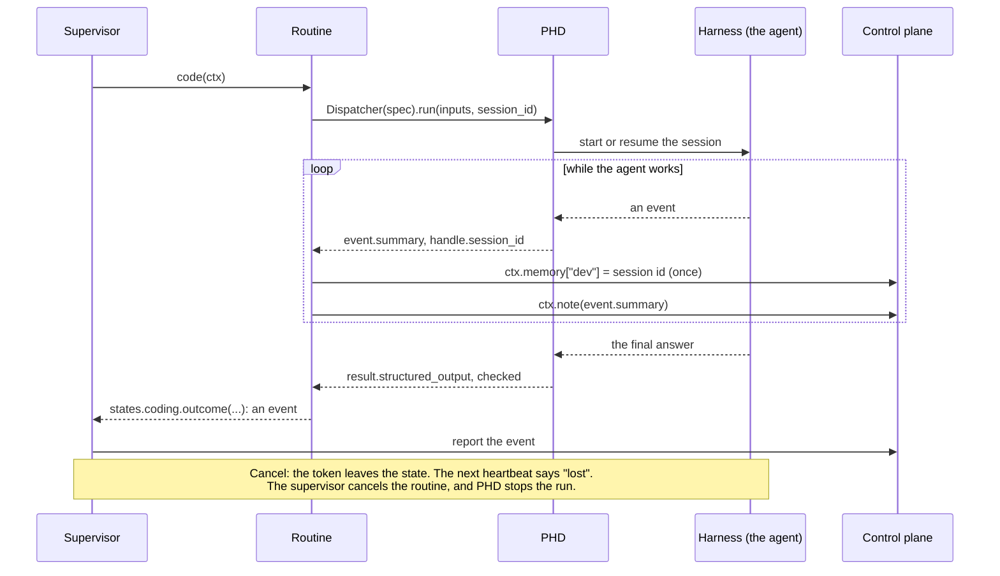

# Agents, with PHD

## In one sentence

A routine runs a coding agent with the library PHD, and Stateous keeps the agent's task alive, its progress visible and its session safe.

## Why it exists

A coding agent can work for an hour, hang, or crash with its computer. Its answer must be one of the outcomes that the state allows. When it fails, the next try should continue its session, not start again.

Stateous and PHD share this work. PHD runs the agent and checks its answer. Stateous keeps the task, the retries and the session id. PHD knows nothing of workflows, and it does not report to Stateous.

## How it works

| Need | Who does it |
|---|---|
| Run the agent | PHD, called by an `async def` routine. |
| Keep the task's lease alive while the agent runs | The supervisor. It sends heartbeats for each task whose routine still runs. |
| Stop the agent when the token leaves the state, or is cancelled | The supervisor cancels the routine. PHD's `async with … run(...)` block stops the run when it ends. |
| Choose the outcome | The agent. PHD's `output_schema` is `states.X.outcome_schema()`, so the agent's answer names one allowed event and its payload. |
| Check the outcome | PHD checks the answer against the schema. `states.X.outcome(...)` makes the event, and the control plane checks it again. |
| See that an agent is stuck | PHD. `Spec.idle_timeout_s` stops a run that sends no event for that long. |
| Show progress | The routine gives PHD's events to `ctx.note(...)`. |
| Keep the session for the next attempt | The routine, with `ctx.memory`. |
| Retry and time out | Stateous, as for each routine. |



### The contract's helpers for agents

The contract gives each state two helpers:

- `states.X.outcome_schema()`: the events that state X can emit, with their payloads, as one JSON schema;
- `states.X.outcome(data)`: the event that `data` names, checked against the schema. It raises `OutcomeError` if `data` does not fit.

### Install PHD

PHD is on PyPI as `poly-harness-dispatcher`. Its import name is `phd`. Install it in the supervisor's environment with the `phd` extra of Stateous:

```bash
pip install "stateous[phd]"     # or: uv add "stateous[phd]"
```

Without PHD, the supervisor cannot import a routine that imports `phd`, and it does not start.

PHD needs a stack and credentials for each run. `phd.Stack.load("stacks/dev")` loads the agent's stack folder: its identity, skills and tools. The path is relative to the folder where the supervisor runs. `phd.Credentials.from_host("claude")` uses the login of the supervisor's computer. The PHD documentation tells how to write a stack.

### What the routine uses from PHD

- `Dispatcher(spec).run(inputs, session_id=...)` is an `async with` block. If the block ends before the run ends, PHD stops the run.
- `handle.session_id` is the harness's session id. It is `None` until the harness reports it.
- `Spec.idle_timeout_s` stops a run that sends no event for that long. The run's status is then `timed_out`, with the error kind `idle`.
- `Spec.timeout_s` is the longest time for one run. Its default is 1800 seconds. Set it when an agent must work longer.
- `event.summary` is one line for a `message`, `tool_call` or `tool_result` event. For other events, it is `""`.
- `result.error.kind` is one of `phd.ERROR_KINDS`. Use the kind, not the message.
- `Spec.cwd` must be a folder that exists. If it does not exist, PHD refuses the spec (`CwdNotFound`).

### Sessions, crashes and retries

The routine keeps the session id in `ctx.memory`, as soon as the harness reports it. The memory is saved at once, so a crash keeps it. The next attempt gives the session id to `run(...)`, and the agent continues its session.

With the error kind `"session"`, PHD cannot resume the session. The routine then deletes the session id from `ctx.memory`. Thus the retry starts a new session. With another kind, the retry resumes the same session.

The running agents of a supervisor are its child processes. PHD ties each agent to its caller, so the agents stop when the supervisor crashes. On Windows, a Job Object stops them. On Linux and macOS, a small reaper process stops the agent's process group. If PHD cannot start this protection, the run continues without it, and `result.warnings` says so.

### Free-form payloads

Codex uses OpenAI's strict structured outputs. These cannot return an object that has no listed properties. Thus a payload model with a `dict[str, Any]` field cannot run on Codex. PHD refuses such a run before it starts (`UnsupportedFeature`). Claude and OpenCode accept it.

## Example

This is the routine of `coding` in the `sdlc` example:

```python
# sdlc-supervisor/coding.py: an agent, run by PHD
import phd

from stateous import on_state

from contract import TicketContext, events, states


@on_state(states.coding)
async def code(ctx: TicketContext) -> events.done | events.stuck:
    spec = phd.Spec(
        harness="claude",
        model="sonnet",
        stack=phd.Stack.load("stacks/dev"),  # the agent: a PHD stack folder
        cwd=ctx["repo"],
        credentials=phd.Credentials.from_host("claude"),  # the login of this computer
        output_schema=states.coding.outcome_schema(),
        idle_timeout_s=900,  # no event for 15 minutes: stop
    )
    inputs = phd.Inputs(msg=f"Implement {ctx['repo']}")
    # Leaving the block stops an unfinished run:
    # an error, or the token left the state.
    async with phd.Dispatcher(spec).run(inputs, session_id=ctx.memory.get("dev")) as handle:
        async for ev in handle.events():
            if handle.session_id and "dev" not in ctx.memory:
                # known when the harness reports it; saved at once, so a crash keeps it
                ctx.memory["dev"] = handle.session_id
            ctx.note(ev.summary)  # progress in the token's history; "" gives no note
        result = await handle.wait()
    if result.status != "succeeded":
        if result.error and result.error.kind == "session" and "dev" in ctx.memory:
            del ctx.memory["dev"]  # the session cannot be resumed: the retry starts fresh
        raise RuntimeError(result.error)  # a failed attempt
    return states.coding.outcome(result.structured_output)
```

- The agent's answer must name `done` or `stuck`, because `output_schema` is `states.coding.outcome_schema()`.
- A failed run raises an exception, so the attempt fails. `coding` has `retries=2`, so the agent gets two more attempts.
- The state's `timeout="6h"` covers all attempts.

## Guarantees

- Only an outcome that the state can emit is accepted. PHD checks it, and the control plane checks it again.
- The task's lease stays alive while the routine runs, for as long as the agent works.
- When the token leaves the state, or is cancelled, the supervisor cancels the routine at the next heartbeat, and PHD stops the run.
- The session id in `ctx.memory` stays after a crash, so the next attempt can resume the session.
- Not guaranteed: that an agent's steps are safe to repeat. After a crash, the agent can repeat its last step or two. Its instructions must make that safe.
- Not guaranteed: free-form payloads on Codex. A `dict[str, Any]` field fails before the run starts.

## See also

- [Context, notes and memory](context-notes-memory.md): `ctx.memory` and `ctx.note`.
- [Tasks and routines](tasks-and-routines.md): `async def` routines, cancel, and retries.
- [Reliability](reliability.md): what happens when the supervisor stops.
- [Write a routine](../how-to/write-a-routine.md): `outcome_schema()` and `outcome()`.
