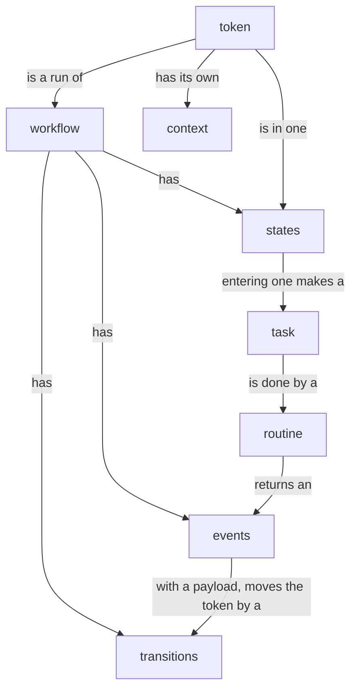
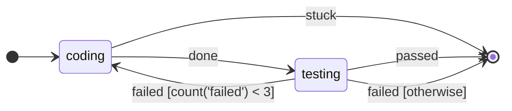

# The model

## In one sentence

A workflow is a graph of states, and a token is one run through that graph, moved only by events.

## Why it exists

A long process has many steps, and each step can take minutes or days. A step can fail, and a computer can stop. You must always know where each run is, and what moves it on.

Stateous puts the process in one graph. The graph tells all the places where a run can be, and all the ways to go on. A run never moves in a way that the graph does not show.

This page defines each word of Stateous. Every other page uses each word in the same sense.

## How it works

You write the workflow in Python, in a file such as `flow.py`. `stateous compile` checks it and writes the graph file. The control plane serves the graph file and keeps every token.

When a token enters a state, the control plane makes a task. A supervisor takes the task and runs your routine for that state. The routine returns an event. The control plane uses the transitions of the graph to choose the next state.



### workflow

The graph of a process: its states, its events and its transitions. You write it in Python with `Workflow(name, context=Model)`. Each workflow has a name, for example `sdlc`.

### state

A place where a token can be. A token is in one state at a time. When a token enters a state, the control plane makes one task for it.

Two states are Stateous's own. `START` is where each token begins, and `END` is where it completes. You do not declare them: import them from `stateous`.

### event

An outcome of a state, for example `passed` or `failed`. Only an event moves a token. An event can have a payload.

Stateous has three events of its own: `timeout`, `error` and `joined`. Your transitions use them by name. You cannot declare them, and you cannot fire them.

### transition

Where an event takes a token: from a source state, on an event, to a target state. A transition can have a guard (`when=`), a condition on the data.

When guards choose between transitions, `otherwise=True` marks the transition to use when no guard matches. Only a transition from `START` has no event.

### token

One run of the workflow, for example `TICKET-1`. It has an id, a state, a status, its context and its history.

The status is `active`, `paused`, `completed`, `failed` or `cancelled`. A token that is `completed`, `failed` or `cancelled` never moves again.

### context

The business data of a token, for example the path of a checkout. A pydantic model gives its fields. A routine reads it as `ctx["key"]`, and can write it.

### payload

The data of one event, for example the numbers of tests that passed and failed. A pydantic model gives its fields. An event without a payload model has no payload.

### task

"Do state S for token T". The control plane queues one task each time a token enters a state. A supervisor claims the task and runs its routine.


### visit

One stay of a token in one state. The first time that a token enters a state is visit 1, the next time is visit 2. A routine reads it as `ctx.visit`. The history shows it, for example `entered coding (visit 2)`.

### claim

A supervisor's request for a task of the states that it serves. The control plane answers with a grant: one queued task, its token, its visit, its attempt and its context. The task is then claimed.

### routine

Your function that does the work of one state. It gets the token's context as `ctx`, and it returns an event. It is in the supervisor's folder, and it is marked with `@on_state(states.X)`.

### supervisor

The process that claims tasks, runs routines, and reports their events to the control plane. You start it with `stateous supervise`. It runs on any computer that can reach the control plane.

### control plane

The process that keeps every token, and chooses each next state. You start it with `stateous serve`. It keeps its data in one SQLite or Postgres database.

### graph file

The compiled workflow, as JSON, for example `sdlc/build/sdlc.json`. `stateous compile` writes it, and `stateous serve` serves it.


### checksum

The hash of the whole graph file, for example `sha256:...`. Each change to the graph file changes it. A supervisor's `contract.py` is for one checksum.

### structure

The hash of the graph file without the `timeout=` and `retries=` of its states. A database serves one structure at a time. See [Change a workflow](../how-to/change-a-workflow.md).

### contract

The file `contract.py` in the supervisor's folder. `stateous init supervisor` writes it from the graph. It gives the states, the events that each state can emit, and the models. It is all that a supervisor knows of the workflow.

### ledger

The history of each token. Each change adds one row, and the rows are never changed. `stateous token show` prints the ledger of a token.

### guard

A condition on a transition, written in `when=`. It reads the context, the payload and counts of events. See [Guards](guards.md).

### timer

An event that the clock fires later, if the token is still in the same state. A state's `timeout=` is a timer too. See [Timers and timeouts](timers.md).

### lease

The time for which a supervisor holds a claimed task. A heartbeat renews it. See [Tasks and routines](tasks-and-routines.md).


### heartbeat

The message that a supervisor sends every 30 seconds for all the tasks that it holds. It renews their leases. Its answer names each task that the supervisor does not hold now, for example because the token left the state.

### attempt

One try of a task. The first claim is attempt 1. When an attempt fails and the state has retries left, the next claim is attempt 2.


### retries

The number of more attempts that a state gives after a failed attempt: `retries=2` gives three attempts in all. After the last failed attempt, the token gets the event `error`.

### note

One line of progress that a routine writes to the token's history with `ctx.note(text)`. See [Context, notes and memory](context-notes-memory.md).

### memory

The routine's own key-value store, for one token and one state: `ctx.memory`. It is saved at once, so it stays after a crash. See [Context, notes and memory](context-notes-memory.md).

### parallel state

A state whose work is other workflows, which run at the same time. It has no task and no routine. See [Parallel and nested work](parallel.md).

### child token

A token that a parallel state starts, one for each workflow of the state. Its parent is the token in the parallel state.


### join

The rule that tells when a parallel state is done. `join="all"` waits for each child token to end. `join="any"` continues when the first child token ends. When the join is met, the control plane fires `joined` on the parent.

### outbox

The supervisor's local file of messages that the control plane did not answer yet: `.stateous/outbox.db`. See [Reliability](reliability.md).

### idempotency key

A key that you give with an event from outside. A second event with the same key applies nothing, and gets the answer "duplicate". See [Reliability](reliability.md).


### held event

An event that comes to a paused token. The control plane keeps it, and applies it on resume, in the order of arrival. The history shows `done held while paused`. See [Pause, resume and cancel](pause-resume-cancel.md).

## Example

The `sdlc` workflow has two states. In `coding`, an agent writes code. In `testing`, a routine runs the tests.

```python
# sdlc/flow.py
from stateous import END, START, Workflow

from schemas import Tests, Ticket

flow = Workflow("sdlc", context=Ticket)

coding = flow.state("coding", timeout="6h", retries=2)
testing = flow.state("testing", timeout="1h")

done = flow.event("done")
stuck = flow.event("stuck")
passed = flow.event("passed", payload=Tests)
failed = flow.event("failed", payload=Tests)

flow.transition(START, coding)
flow.transition(coding, testing, on=done)
flow.transition(coding, END, on=stuck)
flow.transition(testing, END, on=passed)
flow.transition(testing, coding, on=failed, when="count('failed') < 3")
flow.transition(testing, END, on=failed, otherwise=True)
```

```python
# sdlc/schemas.py
from pydantic import BaseModel


class Ticket(BaseModel):
    repo: str  # the path of the checkout, on the supervisor's computer


class Tests(BaseModel):
    passed: int
    failed: int
```

- The context of each token is a `Ticket`. The payload of `passed` and `failed` is a `Tests`.
- A new token goes to `coding` at once.
- `done` takes the token to `testing`. `stuck` ends it.
- `passed` ends the token. A `failed` sends the token back to `coding`, two times. The third `failed` ends it.

This is the graph. `stateous token show --graph` draws the same diagram from the control plane.



## Guarantees

- `stateous compile` refuses a workflow that has a mistake. Examples are a state that no transition reaches, and two guards that can both match.
- A token is in one state at a time. Only an event moves it, and only along a transition of the graph.
- An event that the token's state cannot take is refused. The token stays where it is, and the ledger records the refusal.
- The ledger keeps each change. Stateous never changes or deletes a row of the ledger.
- Not guaranteed: that your routine does the right work. Stateous makes sure only that its outcome is one that the graph allows.

## See also

- [Getting started](../getting-started.md): build the `orders` workflow and run it.
- [The two sides](two-sides.md): the control plane and the supervisor.
- [Tasks and routines](tasks-and-routines.md): how the work of a state is done.
- [Guards](guards.md) and [Timers and timeouts](timers.md).
- [Pause, resume and cancel](pause-resume-cancel.md): the statuses of a token.
- [Write a workflow](../how-to/write-a-workflow.md): from the starter to a workflow of your own.
- [The data](../inside/data.md): the rows of the ledger for one token.
