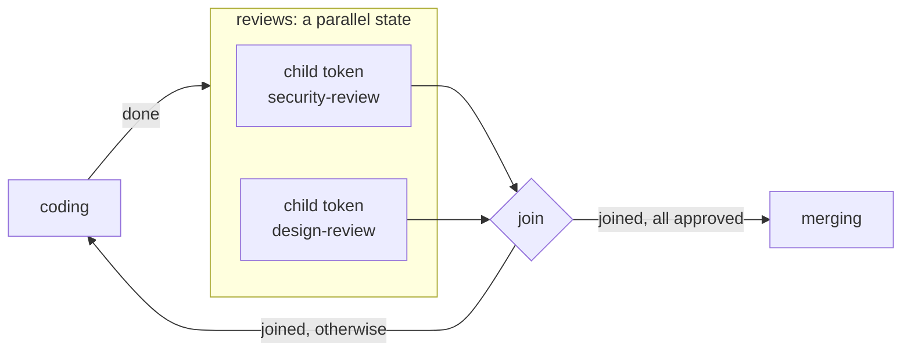
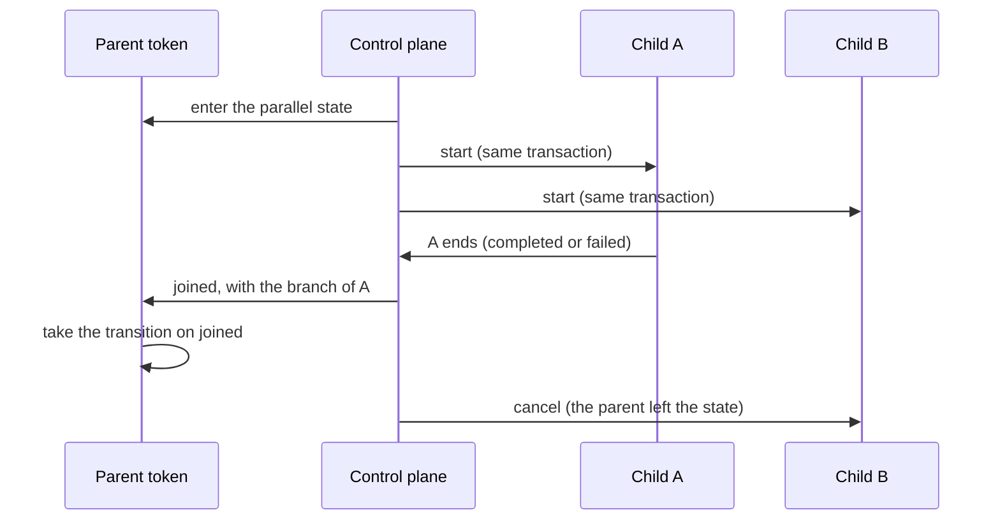

# Parallel and nested work

## In one sentence

A parallel state runs other workflows at the same time, one child token for each, and goes on when their join is met.

## Why it exists

Some work has parts that do not wait for each other. For example, a security review and a design review of the same change. Each part has its own steps, its own failures and its own retries.

You can write each part as a workflow of its own. A parallel state then runs them as child tokens, and the control plane keeps all of them durable. The parent goes on when the parts are done.

## How it works

A parallel state has `parallel=[...]` in place of a routine:

| Argument | What it does |
|---|---|
| `parallel=[wf, ...]` | One child token for each workflow. The state has no routine and no task. |
| `join="all"` | Wait until each child has ended. This is the default. |
| `join="any"` | Continue when the first child ends. The control plane cancels the other children. |
| `inputs=[keys]` | The keys of the parent's context that each child gets as its starting context. |

A parallel state can have `timeout=`. It cannot have `retries=`, because it has no task. It must have a transition on `joined`, and it cannot have a transition on `error`.

Declare the child workflows in the same `flow.py`. `stateous compile` compiles the workflow that no parallel state runs. It makes sure that `inputs=[...]` gives each required field of each child's context model.



### The join

When the join is met, the control plane fires the event `joined` on the parent. Its payload is `{"branches": [...]}`. With `join="all"`, the list has one entry for each child. With `join="any"`, it has the child that ended first. Each entry has these fields:

- `workflow`: the child's workflow;
- `token`: the child's id;
- `status`: `completed` or `failed`;
- `final`: the state that the child was in when it ended;
- `payload`: the payload of the event that brought the child into that state.

A guard on `joined` can use `branches.all(...)` and `branches.any(...)`. In the parentheses, use `workflow`, `token`, `status`, `final` and `payload.field`. The guard can also use `ctx` and `count`.

`stateous compile` cannot prove that two guards with `branches` never overlap. So give the guard to one transition, and make the other the fallback with `otherwise=True`. If no transition takes `joined`, the parent fails.

This is `join="any"`, when one child ends first:



### Child tokens

When the parent enters the state, the control plane starts the children in the same transaction. A child's id is `<parent>.<state>.<visit>.<workflow>`, for example `TICKET-1.reviews.1.design-review`.

A child is a normal token. It has tasks, timers, memory and history. Supervisors claim its tasks as they claim other tasks.

A claim names a child's state as `<workflow>/<state>`, for example `design-review/triage`. In `contract.py`, this state is `states.design_review.triage`, and its events are in `events.design_review`. `stateous init supervisor` writes a stub for each state of each workflow, for example `design_review_triage.py`. A parallel state has no stub.

When a child ends, the control plane checks the join in the same transaction. The parent can leave the state on `joined`, on `timeout`, or on an event that you fire. When the parent leaves the state, the control plane cancels each child that has not ended.

### Steer the parent

`pause` and `resume` on the parent also pause and resume its children. On resume, the events that the parent and its children held apply in the order that they arrived. Thus, with `join="any"`, the child that ended first goes on.

You cannot pause, resume or cancel a child alone. The answer is 409, with the code `child_token`, because a child is a part of its parent's work. Cancel the parent: that cancels its children.

`GET /tokens/{id}` shows a child's `parent`. `GET /tokens?parent=<id>` lists the children. `stateous token show` with the parent's id shows them below the parent.

### Nesting

A child workflow can have parallel states too. `compile` makes sure that a top token id of 64 characters fits below each level of nesting. A token id has at most 128 characters. If a child's id would be longer, the control plane refuses the event that enters the state.

### Tokens that a routine starts

A routine can also start tokens itself, with the client, and return `None`. Each such token then reports to the parent with `fire`. You write the join yourself, with guards and `count('event')`.

## Example

Two reviews run at the same time. The parent goes to `merging` when both approve. Else it goes back to `coding`.

```python
# The parent's workflow (part): two reviews at the same time
security = Workflow("security-review", context=Review)  # its own states, events, transitions
design = Workflow("design-review", context=Review)

reviews = flow.state("reviews", parallel=[security, design], join="all", inputs=["repo", "branch"])
flow.transition(coding, reviews, on=done)
flow.transition(
    reviews,
    merging,
    on="joined",
    when="branches.all(status == 'completed' and final == 'approved')",
)
flow.transition(reviews, coding, on="joined", otherwise=True)
```

Each child gets `repo` and `branch` from the parent's context. For a token `TICKET-1`, the children are `TICKET-1.reviews.1.security-review` and `TICKET-1.reviews.1.design-review`.

## Guarantees

- The children start in the same transaction as the parent's move into the state. All of them start, or none.
- The join is checked in the same transaction as the end of each child. It fires `joined` one time.
- When the parent leaves the state, or is cancelled, each child that has not ended is cancelled.
- A child cannot be steered alone. A pause of the parent always pauses its live children, and a resume resumes them.
- Not guaranteed: that `compile` proves two `branches` guards exclusive. Use one such guard and `otherwise=True`.

## See also

- [The model](model.md): the words [parallel state](model.md#parallel-state) and [child token](model.md#child-token).
- [Guards](guards.md): the guard language.
- [Pause, resume and cancel](pause-resume-cancel.md): steering, and the order of held events.
- [Write a workflow](../how-to/write-a-workflow.md): declare the child workflows in `flow.py`.
