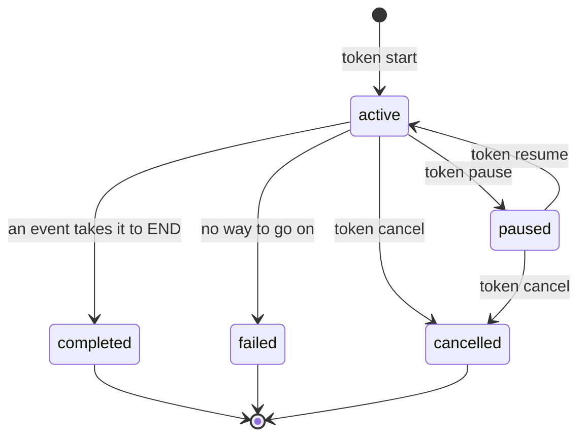

# Pause, resume and cancel

## In one sentence

You can pause a token so that it does not move, resume it so that its held events apply, or cancel it for good.

## Why it exists

Sometimes a person must stop a run: a repository is frozen for a release, or a fault must be examined first. The run must not lose what comes in while it waits.

Sometimes a run is no longer needed. Then all the work that it started must stop, and it must take no more events.

## How it works

A token has one of five statuses. These commands change it:



Only an active token can be paused, and only a paused token can be resumed. `cancel` works on an active or a paused token. Any other request gets the answer 409, with the code `token_not_active`.

### A paused token

A paused token never moves or ends on its own:

- No supervisor takes its queued tasks.
- Its timers and its timeout stop. On resume, they get the paused time back.
- An event that you fire is held. The answer shows the token, still paused.
- A routine that runs already continues, and its lease continues too.
- When that routine returns an event, the control plane holds all of the outcome: the event, the context changes and the timers.
- When that routine returns `None`, the task waits. Its context changes and its timers are saved at once.
- A task that fails holds the event `error` until the resume.

Each held event gets an arrival number. The history shows `done held while paused`.

### Resume

On resume, the held events apply in the order of arrival. Each one applies as if it came now:

- A held event that still fits moves the token. A held outcome also applies its context changes and timers. A timer counts from the resume.
- A held event that no longer fits is dropped and recorded: `dropped on resume`, with the reason.
- A held outcome of a task applies only if the token is still in the same visit of that state. If not, none of its changes apply.

### Cancel

`cancel` stops a token for good. In one transaction, the control plane:

- cancels the token's tasks and timers;
- cancels the token's child tokens;
- deletes the token's memory;
- drops each held event, and records it.

A routine that runs is told at its next heartbeat. The supervisor then cancels an `async def` routine. A cancelled token takes no more events: the answer is 409.

### Child tokens

`pause`, `resume` and `cancel` on a parent also act on its children. You cannot steer a child alone: the answer is 409, with the code `child_token`. See [Parallel and nested work](parallel.md).

## Example

Pause a token, fire an event at it, then resume it:

```bash
stateous token pause TICKET-3
stateous token fire TICKET-3 done
stateous token resume TICKET-3
```

Each command prints the token:

```text
TICKET-3: coding, paused
TICKET-3: coding, paused
TICKET-3: testing, active
```

To stop the token for good, then fire an event at it:

```bash
stateous token cancel TICKET-3
stateous token fire TICKET-3 done
```

A cancelled token takes no event:

```text
TICKET-3: testing, cancelled
error: the control plane at http://127.0.0.1:8080 refused (409): token 'TICKET-3' is cancelled; it takes no events
```

`stateous token show TICKET-3` then shows the held event, when it applied, and the cancel:

```text
TICKET-3: testing, cancelled
22:39:47  #1  started
22:39:47  #2  __started__ in START
22:39:47  #3  entered coding
22:39:47  #4  task 1 queued for coding
22:39:47  #5  timer set: timeout at 2026-10-17 04:39:47
22:39:48  #6  paused
22:39:49  #7  done held while paused
22:39:49  #8  resumed
22:39:49  #9  done applied on resume
22:39:49  #10  done in coding
22:39:49  #11  task 1 cancelled
22:39:49  #12  entered testing
22:39:49  #13  task 2 queued for testing
22:39:49  #14  timer set: timeout at 2026-10-16 23:39:49
22:39:50  #15  task 2 cancelled
22:39:50  #16  cancelled
22:39:51  #17  done refused: token 'TICKET-3' is cancelled; it takes no events
```

No supervisor ran, so no one took task 1 or task 2. The history shows them as `cancelled`.

## Guarantees

- A paused token does not move, and it does not end on its own.
- An event that comes during a pause is not lost. It applies on resume, or it is dropped with the reason in the history.
- Held events apply in the order of arrival, also across a parent and its children.
- A held outcome applies all of its changes, or none of them.
- An idempotency key stays used across a pause. A second delivery during the pause is a duplicate.
- Not guaranteed: that a running routine stops on pause. It continues, and its lease continues.
- Not guaranteed: that a held event still fits on resume. The token can be in a different state then.

## See also

- [The model](model.md): the word [token](model.md#token) and its statuses.
- [Timers and timeouts](timers.md): timers get the paused time back.
- [Reliability](reliability.md): pause and resume among the other mechanisms.
