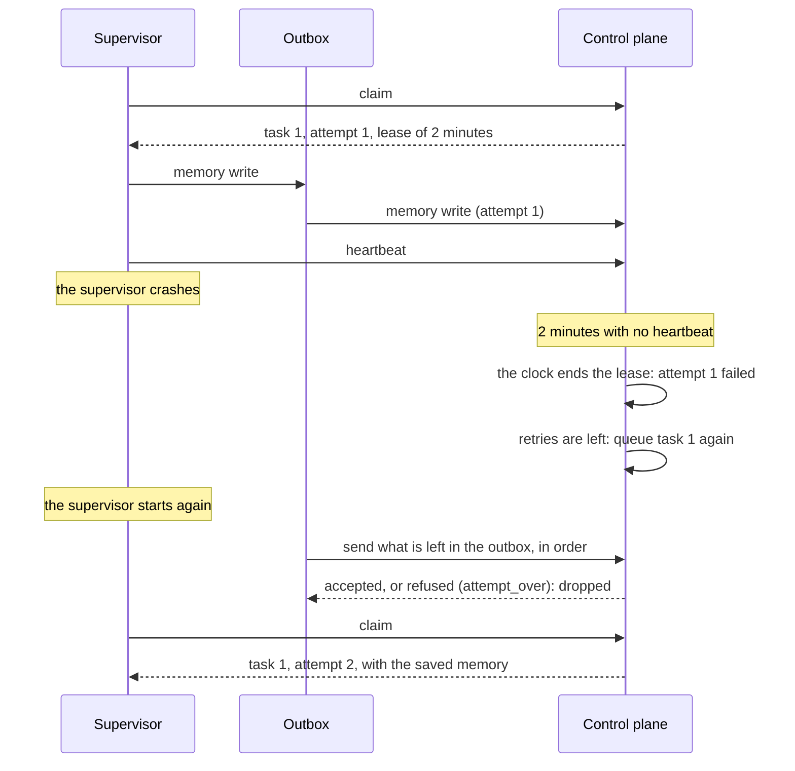

# Reliability

## In one sentence

Seven mechanisms make sure that a token is never lost or moved two times, also when a supervisor, a network or a control plane fails.

## Why it exists

A process can run for days, on many computers. In that time, a supervisor crashes, a network drops, a webhook comes two times, and a deploy restarts everything.

Each of these failures must leave each token in a known state. Each piece of work must also be done again, or not at all, and never lost.

## How it works

These are the seven mechanisms:

| Mechanism | What it protects |
|---|---|
| **The ledger** | Each change adds a row to one table. Tokens, tasks and timers change in the same transaction. A task is never lost between "the token moved" and "the task was queued". |
| **Leases** | A claimed task has a lease of 2 minutes. The supervisor's heartbeat renews it while the routine runs. When a supervisor dies, its leases end, and the tasks are tried again. |
| **The clock** | It fires timeouts and timers, and it ends leases. A timeout is a timer that the state sets when a token enters it. |
| **Idempotency keys** | An event from outside can have a key. A second delivery with the same key gets the answer "duplicate", and changes nothing. |
| **The routine's memory** | An agent's session id stays after a crash and a retry. |
| **The supervisor's outbox** | A report, a note or a memory write goes to a local file first, then to the control plane. A network failure does not lose it. |
| **Pause and resume** | A paused token does not move. Its events wait, and on resume they apply in order. |

### The ledger

The control plane keeps all of its data in one database. Each change to a token is one transaction. The transaction changes the token, its tasks and its timers, and it adds rows to the ledger. Either all of it is saved, or none of it.

Each change locks the token, so one token moves one step at a time. One control plane serves one database. A second control plane on the same database does not start.

### Leases and attempts

An ended lease counts as a failed attempt. The history tells why, for example `task 2 failed: build-box-1 stopped answering: no heartbeat for 2 minutes`. The task then runs again if it has retries left. If not, the token gets the event `error`.

A report for an attempt that is over is refused with 409 and the code `attempt_over`. So a late report of an old attempt cannot land on a new attempt.

A lost claim answer loses nothing. Each claim has a request id. If the answer does not come, the supervisor sends the claim again with the same id. The control plane then gives the same task again, with the same attempt.

### Idempotency keys

`stateous token fire` takes `--key`. Over HTTP, the key is the header `Idempotency-Key` on `POST /tokens/{id}/events/{event}`. A key has 1 to 256 characters.

A key stays used for the life of the token, also across a pause. The duplicate's answer shows the token as it is now.

### The supervisor's outbox

The outbox is the file `.stateous/outbox.db` in the supervisor's folder. The supervisor writes each report, note and memory write to it first. Then it sends the message. The message leaves the outbox when the control plane accepts it or refuses it.

- When the control plane cannot be reached, the message stays. The supervisor tries again after 1, 2, 4, 8 and 16 seconds, then every 30 seconds.
- At start, the supervisor sends the messages that are left, in order. Then it claims new tasks.
- A report counts only if it gets to the control plane before its task's lease ends. After that, the control plane refuses it, and the supervisor drops it with one log line.
- Two supervisors cannot share one outbox. A second supervisor on the same folder does not start.

### When the supervisor stops

- **A graceful stop** (Ctrl-C, SIGTERM): the supervisor takes no new tasks, and it waits for its running routines. A second signal stops it at once. A deploy loses nothing.
- **The control plane cannot be reached at the stop:** the supervisor does not wait for it. The messages stay in the outbox, and the next `stateous supervise` sends them.
- **A crash** (or `kill -9`): the leases end 2 minutes after the last heartbeat. Then the tasks are tried again. With `ctx.memory`, the next attempt can resume an agent's session.

This is a crash, and what happens after it:



### Time limits on Postgres

Each Postgres connection has time limits. So a request does not wait for ever on a bad network or a lock:

| Limit | Value | What it stops |
|---|---|---|
| `connect_timeout` | 10 seconds | A connection that cannot be made. |
| `statement_timeout` | 30 seconds | One statement that runs too long. |
| `lock_timeout` | 10 seconds | A statement that waits too long for a lock, also a token's lock. |
| TCP keepalives | a probe after 30 seconds, then every 10 seconds, 3 probes | A dead connection. It is found in about a minute. |

On SQLite, a transaction waits up to 30 seconds for the write lock of another process. When a limit stops a request, the answer is 503 with the code `database_busy`. Try the request again.

## Example

A webhook comes two times with the same key. Stateous applies it one time:

```bash
stateous token fire TICKET-1 done --key gh-delivery-1
stateous token fire TICKET-1 done --key gh-delivery-1
```

```text
TICKET-1: testing, active
duplicate: TICKET-1: testing, active
```

A supervisor stops during the work of `coding`, which has `retries=2`. The history shows the ended lease, and the next attempt on a different supervisor:

```text
build-box-1 took task 1 (attempt 1)
task 1 failed: build-box-1 stopped answering: no heartbeat for 2 minutes
task 1 is tried again (attempt 2)
build-box-2 took task 1 (attempt 2)
```

## Guarantees

- A token, its tasks and its timers change together, or not at all.
- A claimed task is never lost. If its supervisor stops, the lease ends, and the task runs again or the token gets `error`.
- An event with an idempotency key applies one time.
- A message in the outbox is sent until the control plane accepts it or refuses it.
- A report for an attempt that is over is refused. An old attempt cannot change a new one.
- Not guaranteed: that a routine runs one time only. It can run again after a crash. Make its side effects safe to repeat, for example "check whether the PR exists first".
- Not guaranteed: that a crashed supervisor's late report counts. It counts only before its task's lease ends.

## See also

- [The model](model.md): the words [ledger](model.md#ledger), [lease](model.md#lease), [outbox](model.md#outbox) and [idempotency key](model.md#idempotency-key).
- [Tasks and routines](tasks-and-routines.md): claims, heartbeats and attempts.
- [Context, notes and memory](context-notes-memory.md): the routine's memory.
- [Pause, resume and cancel](pause-resume-cancel.md).
- [Use Postgres](../how-to/use-postgres.md): the database, and its time limits.
- [Run supervisors](../how-to/run-supervisors.md): stop a supervisor safely.
- [The internal workflows](../inside/workflows.md): the steps and events of each mechanism.
