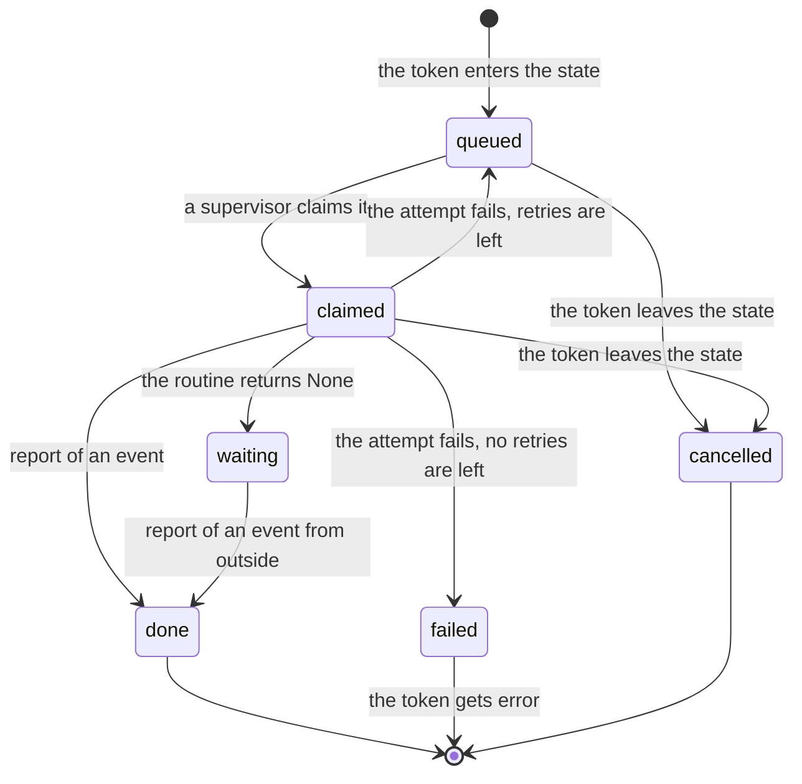
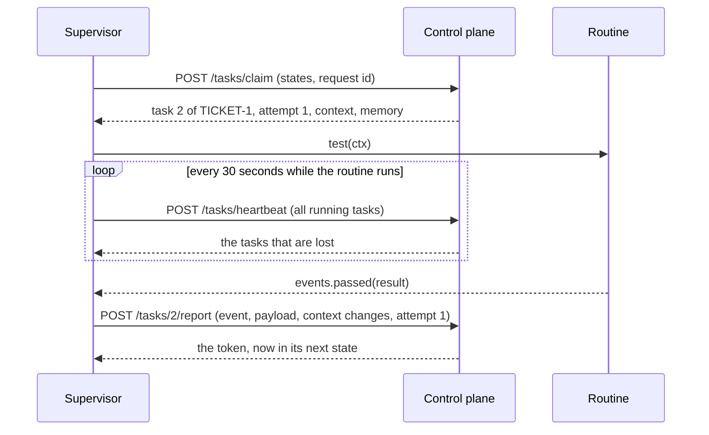

# Tasks and routines

## In one sentence

When a token enters a state, the control plane queues a task, and a supervisor claims it and runs your routine for that state.

## Why it exists

The control plane decides, but it does not do the work. The work must run on the computers that can do it, and it can be slow or fail.

A task is the unit of work that crosses from the control plane to a supervisor. Leases, heartbeats and attempts make sure that a task is never lost. This is true also when a supervisor stops in the middle of the work.

## How it works

A task goes through these steps:

1. **Queue.** When a token enters a state, the control plane queues one task for it, in the same transaction.
2. **Claim.** A supervisor asks for a task of the states that it serves. The control plane gives it the oldest queued task of an active token. The task is now claimed, and its attempt number goes up by 1.
3. **Lease.** A claimed task has a lease of 2 minutes. While the lease runs, no other supervisor can get the task.
4. **Heartbeat.** While the routine runs, the supervisor sends a heartbeat every 30 seconds. One heartbeat names all of its running tasks, and it renews their leases.
5. **Report.** The routine returns, and the supervisor reports the outcome. An event moves the token, and the task is done.

The supervisor reports one of three kinds of outcome:

| Outcome | When | What the control plane does |
|---|---|---|
| an event | The routine returned an event. | It checks the event, and moves the token. The task is `done`. |
| waiting | The routine returned `None`. | The task waits. Someone outside reports its event later. |
| failed | The routine raised an exception. | It counts a failed attempt. |

A failed attempt is not the end. When the state has retries left, the task is queued again, and the next claim is the next attempt. `retries=2` on a state gives three attempts in all. After the last failed attempt, the token gets the event `error`. If no transition takes `error`, the token fails.

An ended lease also counts as a failed attempt. This occurs when a supervisor stops and sends no more heartbeats.

These are the statuses of a task:



A failed attempt can also start from `waiting`, when the report from outside is a failure. A task is also cancelled when the token is cancelled.

This is one task, from claim to report:



### The routine

A routine is a function in the supervisor's folder, marked with `@on_state(states.X)`. It can be a `def` or an `async def`.

- An `async def` routine runs on the supervisor's event loop.
- A `def` routine runs in a thread.
- At most `tasks` routines run at once. `tasks` is a setting in `stateous.yaml`.

The routine's argument is `ctx`. It gives the context, the ids of the token and the task, the visit and the attempt.

When the token leaves the state, or is cancelled, the next heartbeat tells the supervisor that the task is lost. The supervisor then cancels an `async def` routine. It cannot stop a `def` routine, so it ignores the result of that routine.

### A claim that gets no answer

Each claim has a request id. If the answer is lost, the supervisor sends the claim again with the same id. The control plane gives the same task again, with the same attempt, and renews its lease. It does not claim a second task.

## Example

The routine of the state `testing` in `sdlc` runs the tests of a checkout. `run_tests` is a helper in the same file. It runs pytest and returns a `Tests`.

```python
# sdlc-supervisor/testing.py (the routine; the helper run_tests is above it)
from stateous import on_state

from contract import TicketContext, events, states


@on_state(states.testing)
def test(ctx: TicketContext) -> events.passed | events.failed:
    result = run_tests(ctx["repo"])
    return events.passed(result) if result.failed == 0 else events.failed(result)
```

If `run_tests` raises an exception, the attempt fails. `testing` has no `retries=`, so this is the last attempt. `sdlc` has no transition on `error`, so the token fails.

The state `coding` has `retries=2`. A crash of its supervisor gives this history:

```text
task 1 failed: build-box-1 stopped answering: no heartbeat for 2 minutes
task 1 is tried again (attempt 2)
build-box-2 took task 1 (attempt 2)
```

## Guarantees

- Each visit of a token to a state gets exactly one task, except in a parallel state. The task is queued in the same transaction as the move.
- One attempt of a task is held by one supervisor at a time.
- A lost claim answer loses no task, and does not claim a second one.
- A report for an old attempt is refused (409, `attempt_over`). So a late report cannot land on a new attempt.
- A routine can run more than one time for one task: one time for each attempt. Make the work of a routine safe to repeat.
- Not guaranteed: that a `def` routine stops when its task is lost. Its result is ignored, but it runs to its end.

## See also

- [The model](model.md): the words [task](model.md#task), [routine](model.md#routine), [lease](model.md#lease) and [attempt](model.md#attempt).
- [The two sides](two-sides.md): what crosses the network.
- [Timers and timeouts](timers.md): a state's `timeout=` covers all attempts.
- [Context, notes and memory](context-notes-memory.md): every field of `ctx`.
- [Reliability](reliability.md): leases, the outbox, and what happens when a supervisor stops.
