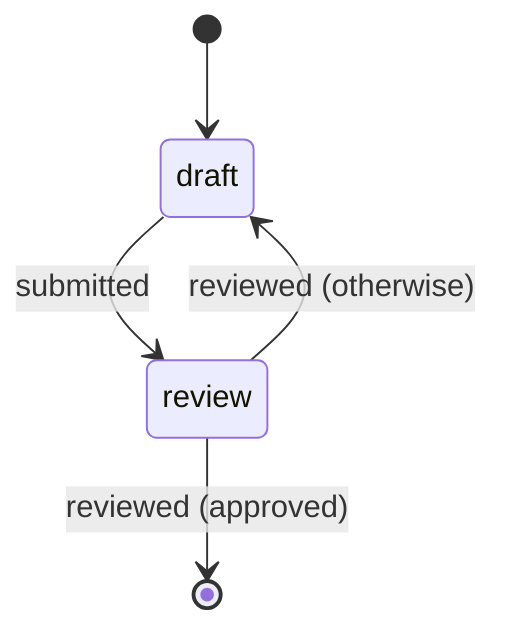
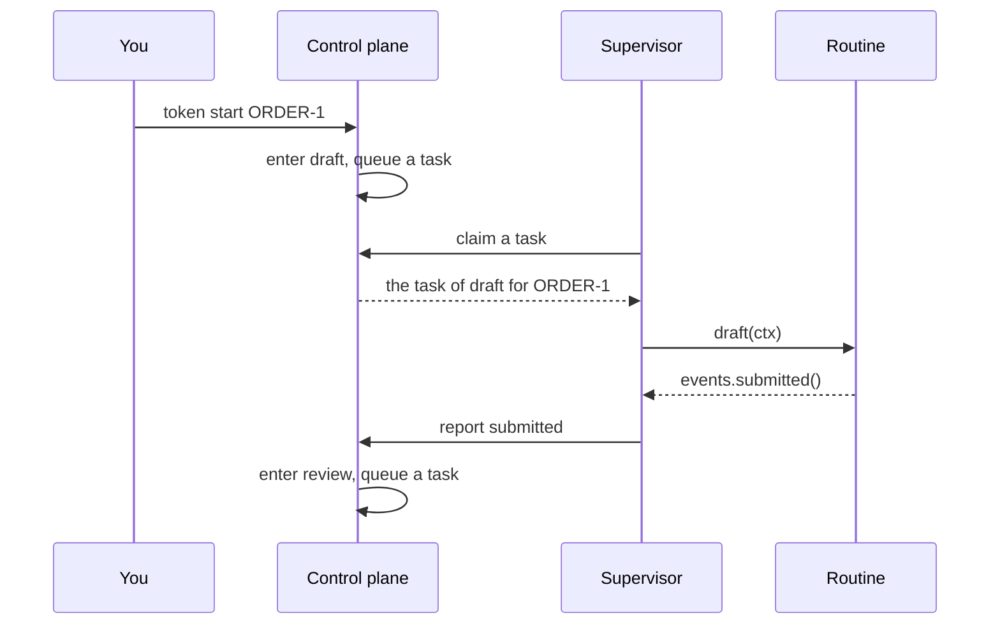

# Getting started

In this tutorial, you build the `orders` workflow and run it on one computer. A token of `orders` goes from `draft` to `review`. A review approves it or sends it back to `draft`. You need Python 3.12 or newer and a shell. You use three terminals, all in the same folder.

!!! note "Windows"
    The commands use the quotes of a POSIX shell, for example Git Bash. Windows PowerShell 5.1 removes the double quotes in a JSON argument. There, write each `"` in the JSON as `\"`, for example `'{\"title\": \"first order\"}'`.

## Install

```bash
pip install stateous            # or: uv add stateous
```

Run each `stateous` command in the environment that has Stateous.

## Write the workflow

Let Stateous write a starter workflow:

```bash
stateous init workflow orders
```

`init` prints the files that it wrote, and the next steps:

```text
wrote    orders/flow.py
wrote    orders/schemas.py
wrote    orders/pyproject.toml
wrote    orders/build/orders.json

Next steps:
  stateous serve orders/build/orders.json
  stateous init supervisor orders/flow.py orders-supervisor
```

On Windows, the paths in these lines have `\` in place of `/`.

This is `orders/flow.py`:

```python
# orders/flow.py: the workflow. `stateous compile orders/flow.py` checks it and writes
# the graph file, orders/build/orders.json.
from stateous import END, START, Workflow

from schemas import Item, Verdict

# The workflow and its name. Each token has a context: an Item (see schemas.py).
flow = Workflow("orders", context=Item)

# The states. A token is in one state at a time. A routine does the work of a state.
# `timeout=` and `retries=` are optional. See
# https://stateouslabs.github.io/stateous/how-to/write-a-workflow/
draft = flow.state("draft")
review = flow.state("review")

# The events: the outcomes that move a token. A payload is optional.
submitted = flow.event("submitted")  # no payload
reviewed = flow.event("reviewed", payload=Verdict)  # the payload is a Verdict

# The transitions: where each event takes a token. START and END begin and end each token.
flow.transition(START, draft)  # a new token goes to `draft` at once
flow.transition(draft, review, on=submitted)
# A guard (`when=`) is optional. Here, the payload of `reviewed` chooses the target.
flow.transition(review, END, on=reviewed, when="payload.approved == true")
# `otherwise=True` marks the transition to use when no guard matches.
flow.transition(review, draft, on=reviewed, otherwise=True)
```

What each part does:

- `Workflow("orders", context=Item)` makes the workflow. A **token** is one run of the workflow. Each token has a **context**: here, an `Item`.
- `flow.state(...)` adds a **state**. A token is in one state at a time. When a token enters a state, the control plane makes a **task** for it.
- `flow.event(...)` adds an **event**: an outcome of a state. Only an event moves a token. An event can have a **payload**, for example a `Verdict`.
- `flow.transition(...)` tells where an event takes a token. `START` is where each token begins, and `END` is where it ends.
- `when=` is a **guard**: a condition on the payload or the context. Here, an approved `Verdict` ends the token.
- `otherwise=True` marks the transition that applies when no guard matches. Here, a `Verdict` that does not approve sends the token back to `draft`.

`orders/schemas.py` holds the two models. `Item` has one field, `title`. `Verdict` has the fields `approved` and `note`.

This is the graph of `orders`:



`init` also compiled `flow.py` to the graph file `orders/build/orders.json`. After you change `flow.py`, compile it again with `stateous compile orders/flow.py`.

## Terminal 1: serve the workflow

```bash
stateous serve orders/build/orders.json
```

The control plane prints `serving on http://127.0.0.1:8080 (Ctrl-C stops)`. It keeps its data in the SQLite file `stateous.db`, in the current folder. Keep it running.

## Terminal 2: the supervisor

Make the supervisor's folder:

```bash
stateous init supervisor orders/flow.py orders-supervisor
```

`init` writes these files in `orders-supervisor/`:

- `contract.py`: the states, the events and the models of `orders`. The routines import it. It is all that the supervisor knows of the workflow.
- `draft.py` and `review.py`: a stub routine for each state. A stub raises `NotImplementedError`.
- `stateous.yaml`: the URL of the control plane, and how many routines run at once.
- `pyproject.toml`: the folder is a Python project of its own.

A **routine** is your function that does the work of one state. It gets the token's context, and it returns an event. Replace the two stubs with these routines.

```python
# orders-supervisor/draft.py
from stateous import on_state

from contract import ItemContext, events, states


@on_state(states.draft)
def draft(ctx: ItemContext) -> events.submitted | None:
    if ctx.visit > 1:  # the review sent the order back
        ctx.note("the review sent this order back: a person must change it")
        return None  # the task waits for a person
    return events.submitted()
```

```python
# orders-supervisor/review.py
from stateous import on_state

from contract import ItemContext, Verdict, events, states


@on_state(states.review)
def review(ctx: ItemContext) -> events.reviewed:
    return events.reviewed(Verdict(approved=ctx["title"] != "reject me"))
```

`draft` submits a new order at once. `review` approves each order, except an order with the title `reject me`. When the review sends an order back to `draft`, `draft` returns `None`: the task then waits for a person, and the token stays in `draft`.

Then run the supervisor:

```bash
stateous supervise orders-supervisor
```

Keep it running. The supervisor takes the tasks of `draft` and `review`, runs the routines, and reports each event.

## Terminal 3: start tokens

Start a token, then show it:

```bash
stateous token start ORDER-1 '{"title": "first order"}'
stateous token show ORDER-1
```

`token start` prints `ORDER-1: draft, active`. One or two seconds later, `token show` prints the token and its history:

```text
ORDER-1: review, completed
22:23:31  #1  started
22:23:31  #2  __started__ in START
22:23:31  #3  entered draft
22:23:31  #4  task 1 queued for draft
22:23:32  #5  build-box-1 took task 1 (attempt 1)
22:23:32  #6  submitted in draft
22:23:32  #7  task 1 done
22:23:32  #8  entered review
22:23:32  #9  task 2 queued for review
22:23:32  #10  build-box-1 took task 2 (attempt 1)
22:23:32  #11  reviewed in review: {"approved": true, "note": ""}
22:23:32  #12  task 2 done
22:23:32  #13  completed
```

The first line gives the last state and the status. `build-box-1` is the name of the supervisor: by default, the host name of its computer.

Start a second token that the review does not approve:

```bash
stateous token start ORDER-2 '{"title": "reject me"}'
stateous token show ORDER-2
```

The review sends `ORDER-2` back to `draft`. There, `draft` returns `None`, so the token waits. `token show` prints these lines:

```text
ORDER-2: draft (visit 2), active
22:23:40  #1  started
22:23:40  #2  __started__ in START
22:23:40  #3  entered draft
22:23:40  #4  task 3 queued for draft
22:23:40  #5  build-box-1 took task 3 (attempt 1)
22:23:40  #6  submitted in draft
22:23:40  #7  task 3 done
22:23:40  #8  entered review
22:23:40  #9  task 4 queued for review
22:23:40  #10  build-box-1 took task 4 (attempt 1)
22:23:40  #11  reviewed in review: {"approved": false, "note": ""}
22:23:40  #12  task 4 done
22:23:40  #13  entered draft (visit 2)
22:23:40  #14  task 5 queued for draft
22:23:40  #15  build-box-1 took task 5 (attempt 1)
22:23:40  #16  the review sent this order back: a person must change it
22:23:40  #17  task 5 waits: the work goes on outside
```

The token stays in `draft` until a person acts. For example, `stateous token cancel ORDER-2` cancels it. [Steer tokens](how-to/steer-tokens.md) tells what else a person can do.

To stop the supervisor and the control plane, press Ctrl-C in terminals 2 and 1.

## What happened

These are the steps of one token, from `token start` to the next state:



The control plane keeps the token, and it chooses each next state. The supervisor never sees the graph. It knows only the states that it serves, and the events that each state can emit.

## Next

- Concepts: [the words of Stateous](concepts/model.md), and [the two sides](concepts/two-sides.md), the control plane and the supervisor.
- How-to guides: [change the starter into a workflow of your own](how-to/write-a-workflow.md), and [write the routines](how-to/write-a-routine.md).
