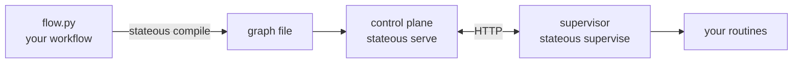

# Stateous

Stateous runs a process as a graph of states. You write the graph in Python. Each run of the process is a **token**, for example one support ticket. A **control plane** keeps every token safe in a database, and chooses each next state. A **supervisor**, on any computer, does the work of each state with your functions, the **routines**.

The supervisor never sees the graph. It knows only which states it serves, and which events each state can return.

Two rules keep the data simple. A routine reads and writes only the token's context, its data. A routine decides, and a guard in the graph only routes. See [Where data goes](concepts/data.md).



## What it guarantees

[Reliability](concepts/reliability.md) tells how each guarantee works, and what is not guaranteed.

- **No lost tasks.** A change to a token, its tasks and its timers is one transaction in one database.
- **A supervisor that stops does not stop a token.** A supervisor holds each task for a limited time, its lease. When the lease ends, the control plane counts a failed attempt. The task runs again if it has retries left; if not, the token gets the event `error`.
- **A duplicate event applies one time.** An event from outside can carry a key. A second event with the same key gets the answer "duplicate".
- **A report survives a network failure.** The supervisor keeps each report in a local file until the control plane accepts it or refuses it.
- **A paused token does not move.** Its events wait, and on resume they apply in order. See [Pause, resume and cancel](concepts/pause-resume-cancel.md).

## Install

Stateous needs Python 3.12 or newer.

```bash
pip install stateous            # or: uv add stateous
pip install "stateous[phd]"     # also PHD (poly-harness-dispatcher), to run coding agents in routines
```

The control plane keeps its data in SQLite or in Postgres.

## Where to start

- [Getting started](getting-started.md): build and run a workflow on one computer.
- [The model](concepts/model.md): the words that you need to build, each defined one time.
- [Where data goes](concepts/data.md): the context, the payload, and the two rules.
- [The two sides](concepts/two-sides.md): the control plane and the supervisor, and what crosses between them.
- [Agents, with PHD](concepts/agents.md): run a coding agent in a routine.
- [Write a workflow](how-to/write-a-workflow.md) and the other how-to guides: do one task, step by step.
- [How Stateous works inside](inside/event-graph.md): the internal workflows, their events, and the tables.
- [The reference](reference/cli.md): every command, route, file and limit.
