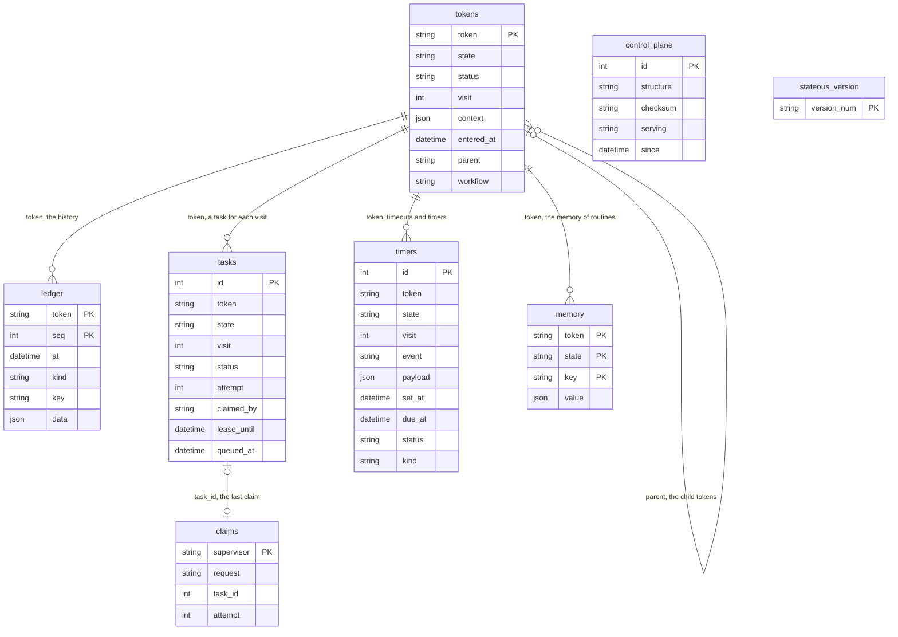
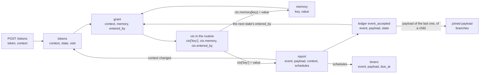

# The data

This page describes the tables of the control plane's database, the supervisor's outbox, and the rows of one token after it completes.

The control plane keeps all of its data in one database, SQLite or Postgres. The supervisor keeps only its outbox, a SQLite file in its folder.

## The tables

The tables have no foreign keys. The diagram shows the logical links: a column that holds the id of a row in a different table.

| Table | What it holds | Which workflows write it |
|---|---|---|
| `ledger` | The history of each token. One row for each change, numbered by `seq` for each token. A row is never changed or deleted. `key` holds the idempotency key of an event from outside. | All workflows that change a token. |
| `tokens` | Where each token is now: its state, its status, its visit of the state, and its context. A child token has `parent` and `workflow`. | Start a token, Fire an event, Report an outcome, Timer fires, Lease expiry, Pause and resume, Cancel, Join. |
| `tasks` | One row each time a token enters a state that is not parallel. `attempt` counts the claims. `lease_until` is set while a supervisor holds the task. | Start a token, Fire an event, Claim a task, Heartbeat, Report an outcome, Lease expiry, Timer fires, Cancel, Join. |
| `timers` | The timeout of a state (`kind` is `timeout`), and the timers of routines (`kind` is `timer`). | Start a token, Fire an event, Report an outcome, Lease expiry, Timer fires, Pause and resume, Cancel, Join. |
| `memory` | The routine's memory: one key and its value, for one token and one state. The rows of a token are deleted when it ends. | Report an outcome (memory writes), and the end of a token. |
| `claims` | The last claim of each supervisor: the request id, and the task and attempt that it got. An empty `task_id` means that the claim got no task. | Claim a task. |
| `control_plane` | One row. The structure and the checksum of the graph on record, and the control plane that holds the database now. | Serve, and its clock. |
| `stateous_version` | The version of the schema of the tables. It has its own name, so a different application can use Alembic in the same database. | Serve, at start. |

Times are in UTC, without a time zone. `stateous token show` prints them in local time.

## The statuses

| Table | Column | Values |
|---|---|---|
| `tokens` | `status` | `active`, `paused`, `completed`, `failed`, `cancelled` |
| `tasks` | `status` | `queued`, `claimed`, `waiting`, `done`, `failed`, `cancelled` |
| `timers` | `status` | `pending`, `fired`, `cancelled` |
| `timers` | `kind` | `timeout`, `timer` |

## The outbox

The outbox is the file `.stateous/outbox.db` in the supervisor's folder. It has one table, `messages`:

| Column | What it holds |
|---|---|
| `id` | The order of the messages. A later message has a higher id. |
| `task`, `attempt`, `token` | The task and the attempt of the grant that wrote the message. |
| `kind` | `report`, `note` or `memory`. |
| `body` | A report: the outcome (`kind`, `event`, `payload`, `error`, `context`, `schedules`). A note: `text`. A memory write: `key` and `value`. |
| `created_at` | When the supervisor wrote it. |

The supervisor writes each message to the outbox, and commits it, before it sends the message. It removes the message when the control plane accepts it or refuses it. After a task is lost, it removes the messages of that attempt. The outbox is empty when all messages went.

## How the data changes along the chain

The data of a token goes from one workflow to the next. This diagram shows where each field comes from, and where it goes:

- The context starts in `POST /tokens`. The control plane adds the defaults of the model, and keeps it in `tokens.context`.
- A grant copies the context and the memory of the state to the supervisor. The routine reads them as `ctx`.
- The routine's writes to `ctx` go back in the report. The control plane checks them against the model, and saves them with the move.
- The event and its payload of the move go to the ledger. The routine of the next state reads them as `ctx.entered_by`.
- For a child token, the payload of the event that brought it into its last state goes into the `joined` payload of its parent.

## A worked example: one token of `orders`

These are the rows of the token `ORDER-1` of the `orders` starter of [Getting started](../getting-started.md), after it completed. They come from a real run on SQLite: `stateous serve`, `stateous supervise`, then `stateous token start ORDER-1 '{"title": "first order"}'`. The host name of the computer is replaced with `build-box-1`.

### `ledger`

| token | seq | at | kind | key | data |
|---|---|---|---|---|---|
| ORDER-1 | 1 | 2026-10-16 20:48:44.845389 | started | | `{"context": {"title": "first order"}}` |
| ORDER-1 | 2 | 2026-10-16 20:48:44.845389 | event_accepted | | `{"event": "__started__", "payload": null, "state": "__start__"}` |
| ORDER-1 | 3 | 2026-10-16 20:48:44.845389 | entered | | `{"state": "draft", "visit": 1}` |
| ORDER-1 | 4 | 2026-10-16 20:48:44.845389 | task_queued | | `{"task": 1, "state": "draft"}` |
| ORDER-1 | 5 | 2026-10-16 20:48:45.546816 | task_claimed | | `{"task": 1, "supervisor": "build-box-1", "attempt": 1}` |
| ORDER-1 | 6 | 2026-10-16 20:48:45.575304 | event_accepted | | `{"event": "submitted", "payload": null, "state": "draft"}` |
| ORDER-1 | 7 | 2026-10-16 20:48:45.575304 | task_done | | `{"task": 1}` |
| ORDER-1 | 8 | 2026-10-16 20:48:45.575304 | entered | | `{"state": "review", "visit": 1}` |
| ORDER-1 | 9 | 2026-10-16 20:48:45.575304 | task_queued | | `{"task": 2, "state": "review"}` |
| ORDER-1 | 10 | 2026-10-16 20:48:45.592695 | task_claimed | | `{"task": 2, "supervisor": "build-box-1", "attempt": 1}` |
| ORDER-1 | 11 | 2026-10-16 20:48:45.609424 | event_accepted | | `{"event": "reviewed", "payload": {"approved": true, "note": ""}, "state": "review"}` |
| ORDER-1 | 12 | 2026-10-16 20:48:45.609424 | task_done | | `{"task": 2}` |
| ORDER-1 | 13 | 2026-10-16 20:48:45.609424 | completed | | `{}` |

Rows with the same `at` were written in one transaction. For example, rows 6 to 9 are the report of task 1: the event, the end of the task, and the entry into `review`.

### `tokens`

| token | state | status | visit | context | entered_at | parent | workflow |
|---|---|---|---|---|---|---|---|
| ORDER-1 | review | completed | 1 | `{"title": "first order"}` | 2026-10-16 20:48:45.575304 | | |

A completed token keeps the state that it came from. `END` is never a value of `state`.

### `tasks`

| id | token | state | visit | status | attempt | claimed_by | lease_until | queued_at |
|---|---|---|---|---|---|---|---|---|
| 1 | ORDER-1 | draft | 1 | done | 1 | build-box-1 | | 2026-10-16 20:48:44.845389 |
| 2 | ORDER-1 | review | 1 | done | 1 | build-box-1 | | 2026-10-16 20:48:45.575304 |

The lease is cleared when a task is done.

### `timers` and `memory`

Both tables are empty. The states of `orders` have no `timeout=`, and the routines set no timers. The routines wrote no memory. Also, the memory of a token is deleted when it ends.

### `claims`

| supervisor | request | task_id | attempt |
|---|---|---|---|
| build-box-1 | eebe09928fb149949cb05e9fcb8740ff | | |

The supervisor claims again each second when it gets no task. So its last claim got no task, and `task_id` is empty.

### `control_plane` and `stateous_version`

| id | structure | checksum | serving | since |
|---|---|---|---|---|
| 1 | sha256:77510d7465e1e6d8061c1018f6f152e6136aa15304b08e92be3efa62174d7851 | sha256:77510d7465e1e6d8061c1018f6f152e6136aa15304b08e92be3efa62174d7851 | build-box-1:17932:a160cedc | 2026-10-16 20:49:08.725674 |

| version_num |
|---|
| 0003 |

`structure` and `checksum` are equal here, because no state has `timeout=` or `retries=`. `serving` names the control plane as `host:pid:id`. The clock writes `since` again about each 10 seconds.

### The outbox

After the run, the table `messages` of `orders-supervisor/.stateous/outbox.db` is empty. Each report reached the control plane.

## See also

- [The internal workflows](workflows.md): the steps that write these rows.
- [Reliability](../concepts/reliability.md): the ledger, leases and the outbox.
- [The model](../concepts/model.md): the words [ledger](../concepts/model.md#ledger) and [outbox](../concepts/model.md#outbox).
