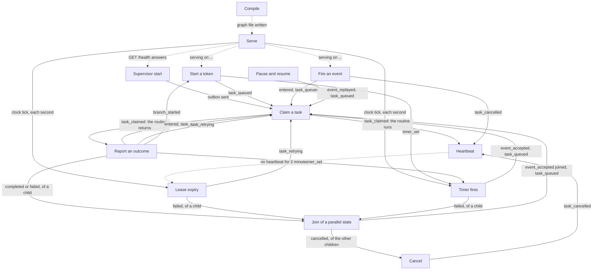

# The event graph

This page shows how the internal workflows of Stateous start each other. An event that one workflow emits is the trigger of the next workflow.

Each node is one workflow of [The internal workflows](workflows.md). Each edge is labelled with the event that starts the next workflow. A ledger entry has its kind from the code, for example `task_queued`.

- A solid edge is a trigger: the event starts the next workflow.
- A dotted edge is a condition: the next workflow can start now, when a person or a program acts.

## How to read it

- **The start.** A person compiles and serves the workflow. Then the clock of `serve` starts [Lease expiry](workflows.md#lease-expiry) and [Timer fires](workflows.md#timer-fires) each second.
- **The main loop.** A token enters a state, and `task_queued` lets a supervisor claim the task. The routine returns, and its report moves the token to the next state. This queues the next task.
- **Failures.** A failed report or an ended lease records `task_retrying`, and the task is queued again. With no retries left, the token gets `error`, or it fails.
- **Lost work.** When a token leaves a state, or is cancelled, `task_cancelled` makes the next heartbeat answer the task as lost. The supervisor then cancels its routine.
- **Parallel states.** Entering a parallel state records `branch_started`, and starts each child token. A child that completes or fails starts the join of its parent.

`branch_started` and the join are also emitted when [Start a token](workflows.md#start-a-token), [Fire an event](workflows.md#fire-an-event) or [Timer fires](workflows.md#timer-fires) move a token. The graph shows each edge one time, from the most usual workflow.

## See also

- [The internal workflows](workflows.md): the five elements of each workflow.
- [The data](data.md): the tables that each workflow changes.
